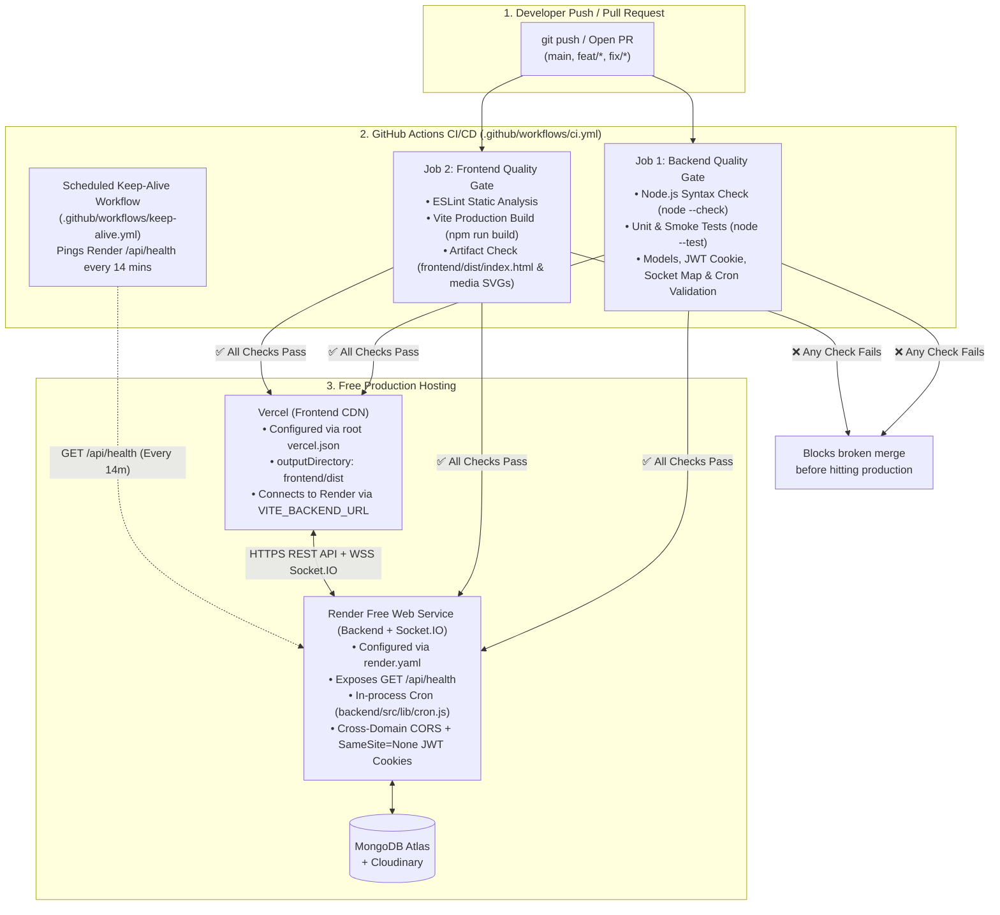
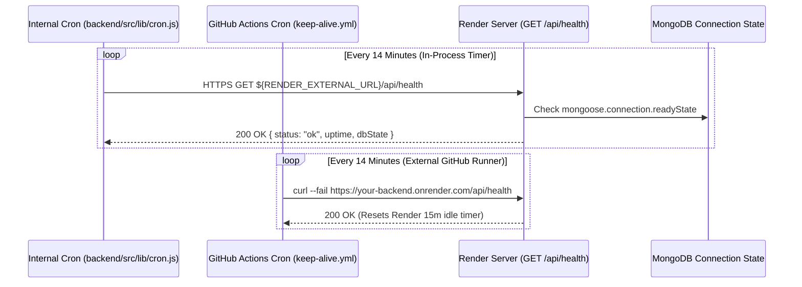

# 🚀 Free CI/CD Pipeline, Render Keep-Alive Cron & Cloud Deployment Guide

This directory documents the **100% Free CI/CD & Production Hosting Architecture** for **Chatty**, using:
- **GitHub Actions** — Automated Testing, Linting, Production Build Verification & External Keep-Alive Cron
- **Vercel (Free Tier)** — Global Edge CDN for the React + Vite Frontend (`frontend/dist`)
- **Render (Free Web Service)** — Persistent Node.js + Express + Socket.IO Backend with built-in Keep-Alive Cron
- **MongoDB Atlas & Cloudinary** — Cloud Database & Media Storage

---

## 1. End-to-End CI/CD & Production Architecture Diagram



---

## 2. How the Keep-Alive Cron Job Works (Preventing Render Cold Starts)

Render's free tier spins down web services after **15 minutes of inactivity**, causing the next user login to wait **30–50 seconds** while the container cold-boots.

We solve this using a **Dual Keep-Alive Cron Architecture**:



### Layer 1: Built-in Node.js Self-Ping Cron (`backend/src/lib/cron.js`)
- Starts automatically when `NODE_ENV === "production"` and either `RENDER_EXTERNAL_URL` (automatically injected by Render!) or `BACKEND_URL` is present.
- Fires every **14 minutes** (`14 * 60 * 1000` ms) to `GET /api/health`.
- Uses `timer.unref()` so it never blocks graceful server shutdowns or test suites.

### Layer 2: External GitHub Actions Scheduled Workflow (`.github/workflows/keep-alive.yml`)
- Runs on a `*/14 * * * *` cron schedule from GitHub's cloud runners.
- Sends an external HTTP request to your Render `/api/health` endpoint so Render sees genuine external ingress traffic.
- **How to enable**: In your GitHub repo, go to **Settings → Secrets and variables → Actions → Variables** and add a repository variable named `RENDER_BACKEND_URL` (e.g., `https://chatty-backend.onrender.com`).

---

## 3. Why `vercel.json` Fixes `[STATIC_BUILD_NO_OUT_DIR]`

Because this repository is a monorepo containing both `backend/` and `frontend/`, running `npm run build` outputs the compiled React bundle into `frontend/dist`.
Without `vercel.json`, Vercel looks for a root `public/` directory and fails with:
`Error: [STATIC_BUILD_NO_OUT_DIR] No Output Directory named "public" found after the Build completed.`

Our root `vercel.json` fixes this permanently:
- `"buildCommand": "npm run build"`
- `"outputDirectory": "frontend/dist"`
- `"rewrites": [{ "source": "/(.*)", "destination": "/index.html" }]` so client-side routes (`/login`, `/signup`, `/settings`, `/profile`) never 404 on browser refresh.

---

## 4. Environment Variables Checklist

### A. Render Dashboard (Backend Web Service)
Set these in **Render → Your Service → Environment**:

| Variable | Example Value | Purpose |
| :--- | :--- | :--- |
| `NODE_ENV` | `production` | Enables production security, cross-domain cookies & keep-alive cron |
| `PORT` | `5001` | Server listening port |
| `MONGODB_URI` | `mongodb+srv://...` | MongoDB Atlas connection string |
| `JWT_SECRET` | `your_strong_secret_key` | Signs 7-day authentication tokens |
| `CLOUDINARY_CLOUD_NAME` | `your_cloud_name` | Cloudinary image uploads |
| `CLOUDINARY_API_KEY` | `your_api_key` | Cloudinary API key |
| `CLOUDINARY_API_SECRET` | `your_api_secret` | Cloudinary API secret |
| `FRONTEND_URL` | `https://your-app.vercel.app` | Allows your Vercel domain in Express & Socket.IO CORS |
| `BACKEND_URL` | `https://your-api.onrender.com` | *(Optional)* Auto-detected on Render via `RENDER_EXTERNAL_URL` |

### B. Vercel Dashboard (Frontend Project)
Set this in **Vercel → Project Settings → Environment Variables**:

| Variable | Example Value | Purpose |
| :--- | :--- | :--- |
| `VITE_BACKEND_URL` | `https://your-api.onrender.com` | Points Axios (`/api`) and Socket.IO client to your Render backend |

---

## 5. Running CI Checks Locally Before Pushing

You can run the exact same checks that GitHub Actions runs using a single command from the root folder:

```bash
# Run backend syntax checks, unit tests, frontend ESLint, and production build
npm run ci
```